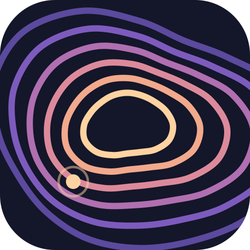
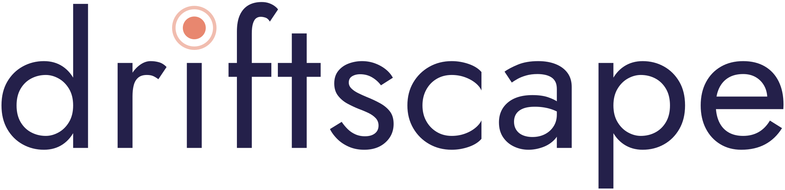

<p align="center">
  
</p>

<h1 align="center">
  <picture>
    <source media="(prefers-color-scheme: dark)" srcset=".github/brand/driftscape-wordmark-dark.svg">
    
  </picture>
</h1>

<p align="center">
  <em>Ambient soundscapes: composable, location-aware, generated in your browser.</em>
</p>

Driftscape is a listening platform for ambient music and soundscapes. Tracks are small and loop
gaplessly, scenes are layered from loops and field recordings, and a MusicGen model runs on the
listener's own GPU through WebGPU, so generation costs the server nothing. Later, soundscapes can be
tied to places and shift as you move. Built with Phoenix.

---

## Use

Driftscape runs on your own machine. On a Mac with Apple silicon it generates faster than real time on the GPU.

```bash
driftscape live "rain on a tin roof, soft guitar"     # endless, steer it by typing while it plays
driftscape live --genre ambient-techno                # ambient, synthetic-ambience, realistic-ambience, ambient-techno, thematic
driftscape radio                                      # list stations
driftscape radio deep-space --stop-after 45           # a station, with a sleep timer
driftscape gen "warm ambient pads" --seconds 10 -o pads.wav
driftscape gen "dub techno, soft kick" --bpm 118 --bars 8 --rate 48000 -o dub.wav   # DAW-ready loop
driftscape loop pads.wav --bars 4 -o loop.wav         # cut a seamless loop
driftscape loop dub.wav --bars 4 --to-bpm 124 -o dub-124.wav   # refit to another tempo
```

Live and radio sessions are recorded to `~/Music/Driftscape` (`--record <path>` or `--no-record`).

### In the browser

`driftscape serve` opens the web app on this machine with the native engine behind it. The same app also runs on its
own as a static site: MusicGen then runs in the browser on WebGPU (about half real time on an M4, so live mode repeats
more), and the model (about 570 MB) is downloaded once and cached.

The model files (MusicGen small) go in `~/Library/Application Support/Driftscape/models/musicgen-small/`:
`tokenizer.json` and `onnx/{text_encoder,decoder_model_merged,encodec_decode}_q4.onnx` from
[Xenova/musicgen-small](https://huggingface.co/Xenova/musicgen-small), and `safetensors/model.safetensors` from
[facebook/musicgen-small](https://huggingface.co/facebook/musicgen-small) for the GPU. MusicGen's weights are licensed
CC-BY-NC 4.0.

## Development

```bash
mise run test                                         # tests, clippy, fmt
mise run web                                          # build the web app into web/build
mise run serve                                        # web app + native engine at localhost:4321
cargo run --release -p driftscape -- live
```

Genres and stations are TOML files in `presets/`. The plan lives in `.claude/VISION.md`.

## License

The code is MIT licensed (see `LICENSE`). MusicGen's model weights are a separate work, licensed CC-BY-NC 4.0
(non-commercial) by Meta; they are downloaded from Hugging Face, not included here.
