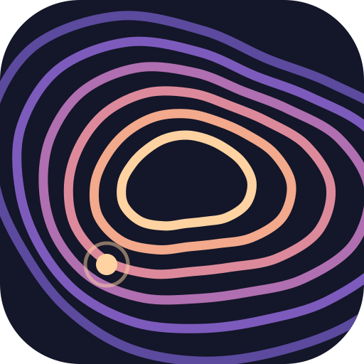

  

<h1 align="center">
  <picture>
    <source media="(prefers-color-scheme: dark)" srcset=".github/brand/driftscape-wordmark-dark.svg">
    
  </picture>
</h1>

  <em>Ambient soundscapes: composable, location-aware, generated in your browser.</em>

Driftscape is a listening platform for ambient music and soundscapes. Tracks are small and loop
gaplessly, scenes are layered from loops and field recordings, and a MusicGen model runs on the
listener's own GPU through WebGPU, so generation costs the server nothing. Later, soundscapes can be
tied to places and shift as you move. Built with Phoenix.

---

## Development

To start your Phoenix server:

* Run `mix setup` to install and setup dependencies
* Start Phoenix endpoint with `mix phx.server` or inside IEx with `iex -S mix phx.server`

Now you can visit [`localhost:4000`](http://localhost:4000) from your browser.

Ready to run in production? Please [check our deployment guides](https://hexdocs.pm/phoenix/deployment.html).

## Learn more

* Official website: https://www.phoenixframework.org/
* Guides: https://hexdocs.pm/phoenix/overview.html
* Docs: https://hexdocs.pm/phoenix
* Forum: https://elixirforum.com/c/phoenix-forum
* Source: https://github.com/phoenixframework/phoenix
